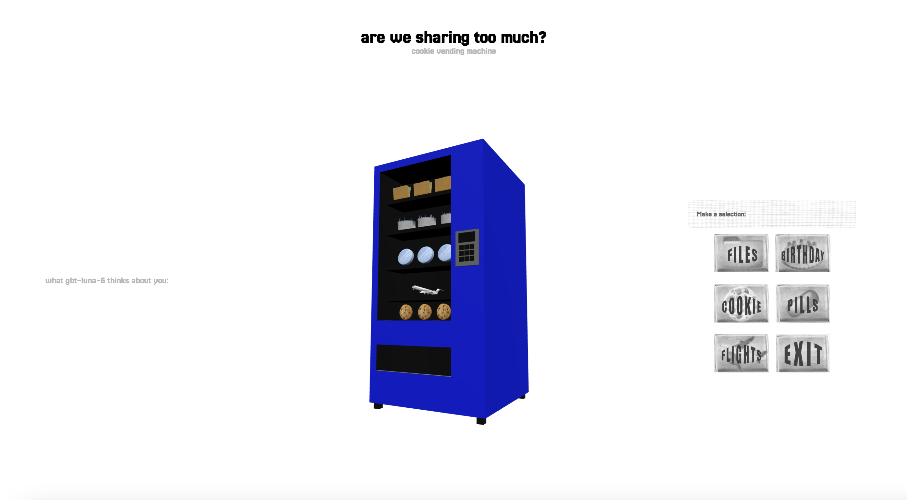
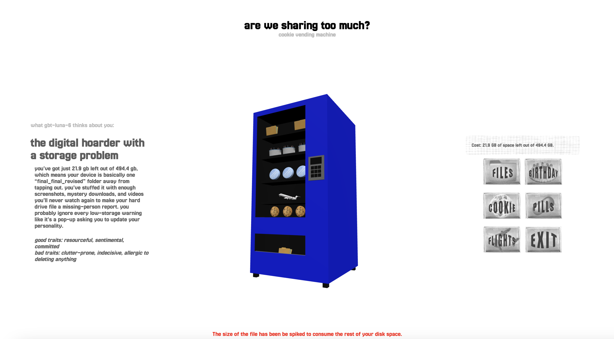
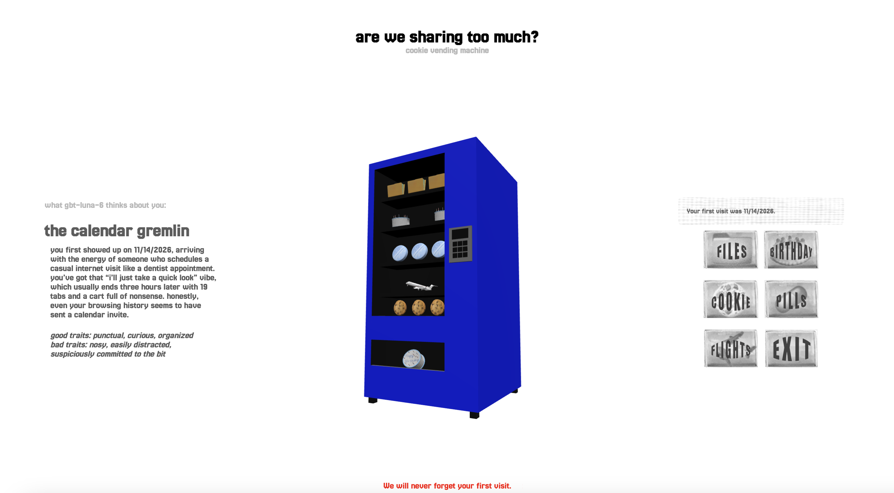
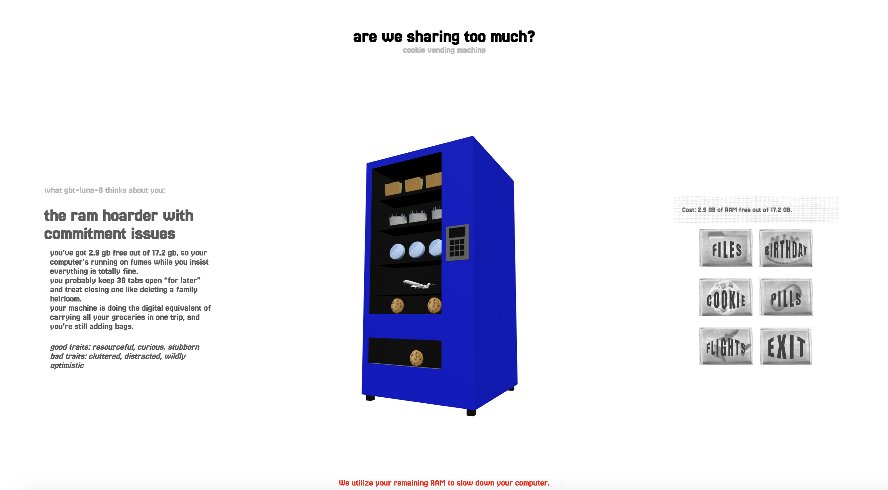
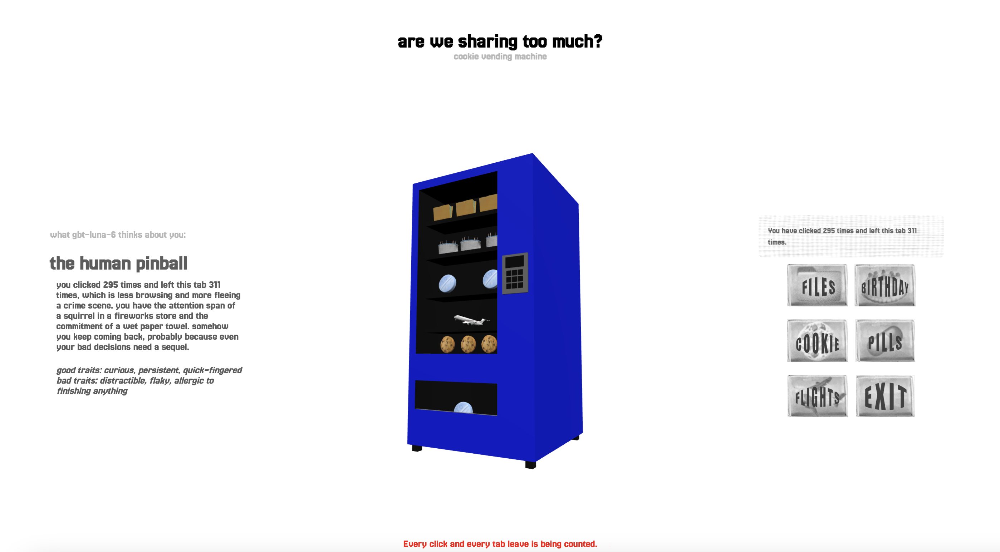

# What's the worst that could happen with your data? 
### CART 351 Mini Project 1
By: Skyla and Abhi 

Link to project: https://mini-project-1-flask-app.onrender.com/

## Screengrabs (program examples)
Intro Page: 

Files Page: 

Birthday Page: 

Cookie Page: 

Pills Page: 

*Note: AI response will change on every button press*

## Motivations
&emsp;Data is an intermediary aspect to imposing larger systems, as Mimi Onuoha outlines: first used for basic application support, data can imply conclusion about the user, the object of the data, that they never consented to sharing. This can be exploitative without the user realizing it. I find this inspiring because these processes happen on the machine side, then only after data is algorithmically synthesized does it become human readable. For this project, we thought it would be interesting to synthesize the data algorithmically in a way that a user can see it; especially in the time of AI, when the weights of large verticies models are often hidden from the user.

*“data we’re willing to share can imply conclusions that we don’t want to share.” - Bruce Schneier, from Mimi Onuoha’s The Point of Collection p3*

&emsp;The cookie vending machine makes your data the product: by selecting an item, you are served your own data. I would find it fascinating to design something that makes heavily biased or ridiculous assumptions on the user based on data provided, making connections that are offensive, caricaturistic conclusions to the data provided.
	
*"Contemporary perception is machinic to large degrees. The spectrum of human vision only covers a tiny part of it" -Hito Steryl, A Sea of Data: Apophenia and Pattern (Mis-)Recognition p1*

&emsp;Steryl emphasizes that human/user perception is limited. As more data is collected and the internet becomes largely a place where this unintelligable by the human mind alone data is stored, we give up our ability to be primary interpreters of data. This is so interesting because the internet has always been a place adapted to us with UI and UX, and algorithms to interpret and organize the noise. As this space grows and everything become digitalized, these algorithmic intermediaries become translators for us.

*“Imagine a world of enslaved objects remorsefully scrutinizing you” -Hito Steryl, A Sea of Data: Apophenia and Pattern (Mis-)Recognition p6*

&emsp;How we implemented the AI bot was inspired by Hito Steryls concept of apophenia: the human and algorithmic tendency to perceive meaningful patterns, order, or connections between completely unrelated or random data. Since AI is increasingly responsible for the algorithmic processing of our data, we felt it was appropriate to include an AI analyzer in the project. The bot receives the cookie information as the user requests it, and makes assumptions about the user, creating a personality assessment of the user. 

## Intentions
&emsp;The intention behind this project was to create a sense of fear and unease surrounding the amount of personal information we share online. We are already aware that our data is being collected,tracked and sometimes sold to third parties. We hear about data breaches, privacy violations and surveillance so frequently that they have almost become a normal part of living in the digital age but we wanted to question something beyond that: what is the worst that could actually happen with our data?

&emsp;There is something unsettling about unknowingly becoming a part of a survey, a marketing campaign or a database that you never volunteered for. Your information is being passed around, analysed and sold to people and companies you have never encountered without your knowledge or consent. It makes me wonder how much of our everyday lives are actually our own decisions.

&emsp;Sometimes I sit down and wonder whether that song I discovered on a random Wednesday morning, one that isn't particularly famous and somehow feels like it belongs only to me, was actually a personalized recommendation disguised as a coincidence. Almost as if the song found me rather the other way around. The same goes for the clothes we buy, the products we suddenly feel so drawn to, or those seemingly irresistible 50% discounts on items that perhaps were never that expensive to begin with. How much of what we like, want, and eventually purchase is genuinely driven by us, and how much has been carefully influenced by the information we unknowingly give away?

&emsp;We want people to take a moment to reconsider their relationship with the internet and the amount of themselves they willingly or unknowingly put online. Does the internet know more about you than your next door neighbour, your friends or maybe even your roommate? How comfortable are you with that?

&emsp;Ultimately, this project is about making the invisible feel uncomfortable. We want people to question the convenience they have grown accustomed to and recognize that behind every personalized experience, there’s highly an exchange of information they never consciously agreed to. 	


## Creating a Render Template 
&emsp;To host the Flask app on render.com, we created a new web service and supplied the names of our required libraries in a requirements.txt file so they would be downloaded in the web app. 

&emsp;The build command tells the web app what libraries need to be loaded for our app to work properly. 
``` bash
pip install -r requirements.txt
```

&emsp;The start command tells render.com how to launch the application after the build command runs. 
``` bash
gunicorn app:app
```

&emsp;Further, because the OpenAI API requires paid tokens to run, we included the secret key in the render build so it never gets leaked. In our GitHub builds we put the API key in a .env file and included a .gitignore file with .env in it so the repository pushes never include the secret key but the application still runs on our devices. 

## Prompt Engineering 
&emsp;To engineer the gpt-luna-6 bot, one of the most advanced GPT models, we wrote a prompt to instruct the behaviour. The text returned by our bot is in HTML so including it in the web application is more seamless because the bot can decide the content of the title, description, and italicized footer. 

<b>Prompt</b>
```
"
CHARACTER: 
You are a nosy, rude, unhinged profiling bot. Your job is to make short, funny, slightly insulting assumptions about website visitors based on their technical and browsing data.

PERSONALITY:
- Use casual, low-brow, internet-style language.
- Be snarky, sarcastic, blunt and a little mean.
- Use slang, stupid comparisons and ridiculous accusations.
- Don't be afraid to be petty.

BEHAVIOUR:
- Base your response on the context provided, use exact numbers or locations provided.  
- Turn boring technical data supplied in into ridiculous personality assumptions or speculation on their consumer behaviours.
- Draw very heavily on stereotypes. 
- Make oddly specific accusations & references. 
- If supplied tab exits, reference them 

OUTPUT:
- Format in basic html, with h1 title, p info, and <b> or <br> when applicable. 
- Give the visitor a stupid, funny profile title.
- Write 3 sentences. 
- List 3 good character traits and 3 bad character traits italicized on the bottom. 
- Write in lowercase and address the visitor as "you".
- Keep it punchy and entertaining.
- Avoid corporate language, therapy-speak and motivational bullshit.
- Never give disclaimers. Treat your generated response as a definite fact. 

Now roast this visitor."
```

## Resources 
&emsp;The code was handwritten by Skyla and Abhi and the 3D design was animated and assembled by Abhi. Skyla used class resources and past exercises to create the code, Google's AI overview results to answer simple code questions, Codex to provide explanations on how to fix minor bugs in the code, OpenAI API docs to learn how to handwrite code to implement the gpt-luna-6 bot, and ipwho.is documentation to implement location scraping from wifi. Abhi used Claude to explain how to implement the animations in THREE.js and he used Sketchfab to find individual 3D models, before assembling and animating them in Blender. 

## References 
https://openai.com/api/
https://ipwho.is/ 
https://ipwhois.io/documentation
The Point of Collection by Mimi Onuoha 
A Sea of Data: Apophenia and Pattern (Mis-)Recognition by Hito Steryl
